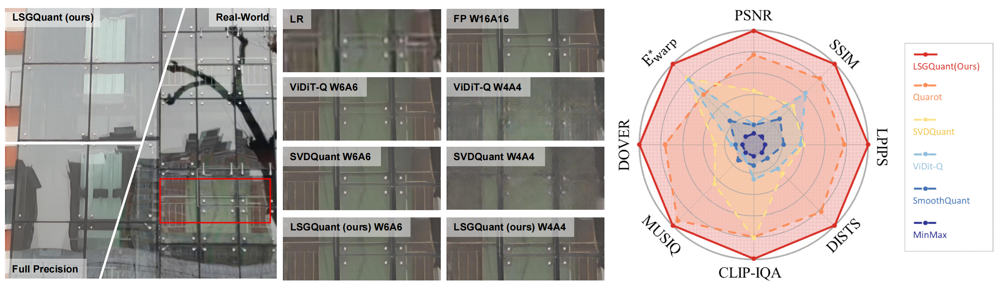
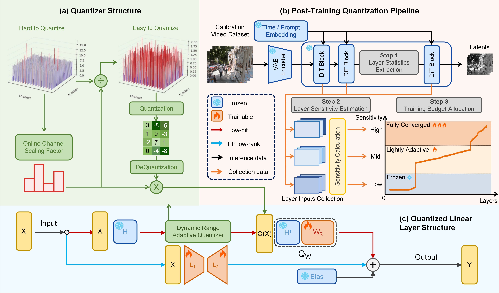
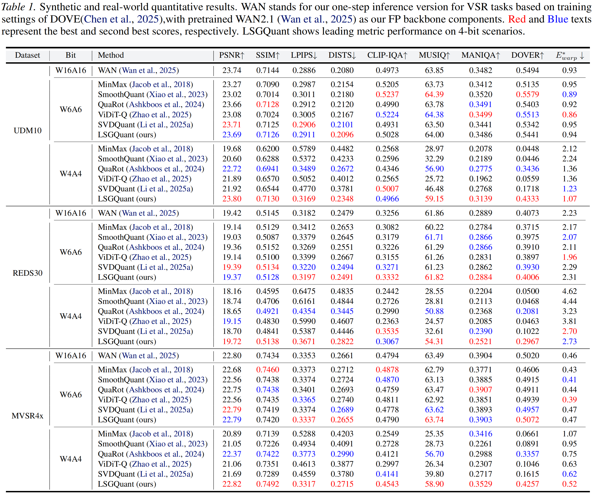
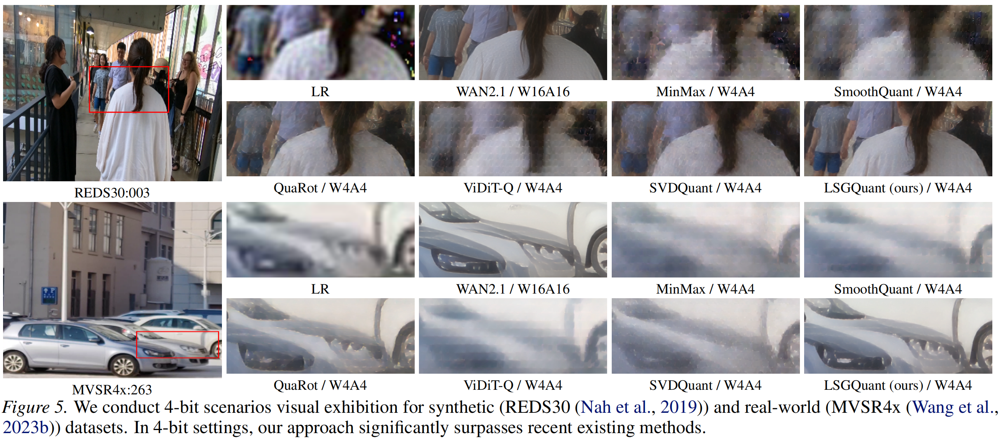

# [ICML 2026] LSGQuant: Layer-Sensitivity Guided Quantization for One-Step Diffusion Real-World Video Super-Resolution

[Tianxing Wu](https://github.com/wutianxing0626) *, [Zheng Chen](https://zheng-chen.cn/) *, [Cirou Xv](https://github.com/xucirou), [Bowen Chai](https://github.com/bowenchai), [Yong Guo](https://www.guoyongcs.com/), [Yutong Liu](https://isabelleliu630.github.io/), [Linghe Kong](https://www.cs.sjtu.edu.cn/~linghe.kong/), and [Yulun Zhang](http://yulunzhang.com/)†

"LSGQuant: Layer-Sensitivity Guided Quantization for One-Step Diffusion Real-World Video Super-Resolution", ICML, 2026

<div>
<a href="https://github.com/zhengchen1999/LSGQuant/releases" target='_blank' style="text-decoration: none;"></a>
<a href="https://github.com/zhengchen1999/LSGQuant" target='_blank' style="text-decoration: none;"></a>
<a href="https://github.com/zhengchen1999/LSGQuant/stargazers" target='_blank' style="text-decoration: none;"></a>
</div>

[[project](https://zheng-chen.cn/LSGQuant/)] [[arXiv](https://arxiv.org/abs/2602.03182)] [[supplementary material](https://github.com/zhengchen1999/LSGQuant/releases/download/supplement-v1/Supplementary_Material.pdf)]

#### <a name="news"></a>🔥🔥🔥 News

- **2026-10-15:** Code, calibration statistics and quantization weights are released.
- **2026-02-04:** This repo is released.

---

> **Abstract:** One-Step Diffusion Models have demonstrated promising capability and fast inference in video super-resolution (VSR) for real-world. Nevertheless, the substantial model size and high computational cost of Diffusion Transformers (DiTs) limit downstream applications. While low-bit quantization is a common approach for model compression, the effectiveness of quantized models is challenged by the high dynamic range of input latent and diverse layer behaviors. To deal with these challenges, we introduce LSGQuant, a layer-sensitivity guided quantizing approach for one-step diffusion-based real-world VSR. Our method incorporates a Dynamic Range Adaptive Quantizer (DRAQ) to fit video token activations. Furthermore, we estimate layer sensitivity and implement a Variance-Oriented Layer Training Strategy (VOLTS) by analyzing layer-wise statistics in calibration. We also introduce Quantization-Aware Optimization (QAO) to jointly refine the quantized branch and a retained high-precision branch. Extensive experiments demonstrate that our method has nearly performance to origin model with full-precision and significantly exceeds existing quantization techniques.



---

### Method Overview



## 📚 Table of Contents

- [Installation](#installation)
- [Datasets](#datasets)
- [Pretrained Models](#pretrained-models)
- [Calibration](#calibration)
- [PTQ & Quantization](#ptq--quantization)
- [Inference](#inference)
- [Evaluation](#evaluation)
- [Results](#results)
- [Citation](#citation)
- [Acknowledgements](#acknowledgements)

---

## ⚙️ Installation

```bash
git clone https://github.com/zhengchen1999/LSGQuant.git
cd LSGQuant
conda create -n lsgquant python=3.10 -y
conda activate lsgquant
pip install -r requirements.txt
```

`requirements.txt` pins the versions used in the paper (torch 2.7.1 + CUDA 12.6).

FFmpeg is needed to write the videos (`imageio-ffmpeg` provides a build).

The evaluation benchmarks are vendored in `eval_metric/` and need two extra
one-time steps, both run from the repository root:

```bash
pip install -e eval_metric/DOVER --no-deps
bash scripts/setup_eval_raft.sh
```

## 📁 Datasets

All datasets are expected under `data/`:

```text
data/
└── VSR_test/
    └── [DatasetName]/
        ├── GT/         # ground truth frames (one folder per clip)
        ├── GT-Video/   # ground truth videos (lossless mkv)
        ├── LQ/         # low-quality frames (one folder per clip)
        └── LQ-Video/   # low-quality videos (lossless mkv)
```

### 🗳️ Test Datasets

| Dataset | Type | # Num | Download |
| :--- | :--- | :---: | :--- |
| UDM10 | Synthetic | 10 | [Google Drive](https://drive.google.com/file/d/1AmGVSCwMm_OFPd3DKgNyTwj0GG2H-tG4/view?usp=drive_link) |
| SPMCS | Synthetic | 30 | [Google Drive](https://drive.google.com/file/d/1b2uktCFPKS-R1fTecWcLFcOnmUFIBNWT/view?usp=drive_link) |
| YouHQ40 | Synthetic | 40 | [Google Drive](https://drive.google.com/file/d/1zO23UCStxL3htPJQcDUUnUeMvDrysLTh/view?usp=sharing) |
| REDS30 | Synthetic | 30 | [OneDrive](https://1drv.ms/u/c/11b213ff6bce81e0/EcG0Wq3K1KlKieRs2dFg1AsBnLghD271-1tnas-WCyevGA?e=t6l2SK) |
| RealVSR | Real-world | 50 | [Google Drive](https://drive.google.com/file/d/1wr4tTiCvQlqdYPeU1dmnjb5KFY4VjGCO/view?usp=drive_link) |
| MVSR4x | Real-world | 15 | [Google Drive](https://drive.google.com/file/d/16sesBD_9Xx_5Grtx18nosBw1w94KlpQt/view?usp=drive_link) |

The upscaling factor for UDM10, SPMCS, YouHQ40 and
REDS30 is 4×, while RealVSR and MVSR4x is 1×.

### 🗳️ Calibration Data

The calibration set follows the **HQ-VSR** pipeline of [DOVE](https://github.com/zhengchen1999/DOVE).

| Dataset | Type | # Videos | Download |
| :--- | :--- | :---: | :--- |
| HQ-VSR | Video | 2,055 | [Google Drive](https://drive.google.com/file/d/1a4-n8WpV8rJar5qOFJ0GyivhZCv5bCQD/view?usp=sharing) |

```text
data/
└── VideoSR/
    └── HQ-VSR/         # *.mp4
```

## 📥 Pretrained Models

| Model | Description | Download |
| :--- | :--- | :--- |
| WAN2.1-T2V-1.3B | FP backbone: DiT + VAE, from the [official WAN2.1 release](https://huggingface.co/Wan-AI/Wan2.1-T2V-1.3B) ([ModelScope mirror](https://modelscope.cn/models/Wan-AI/Wan2.1-T2V-1.3B)) | [HuggingFace](https://huggingface.co/Wan-AI/Wan2.1-T2V-1.3B) |
| LSGQuant FP | Full-precision (W16A16) one-step VSR weights | [Google Drive](https://drive.google.com/open?id=1j6dqZvq6hRtxCt4vYP1W9T0NORKkqCtf) |
| LSGQuant W4A4 | Quantized weights | [Google Drive](https://drive.google.com/open?id=1j5GzdnvkHSRGgZ6tDLy_WVa_y_7ZwMAc) |
| LSGQuant W6A6 | Quantized weights | [Google Drive](https://drive.google.com/open?id=17zEsGSq3cpz_Ij0DzXUiPIex3qrqF_wM) |
| LSGQuant calibration statistics | Layer-sensitivity statistics of the released weights, only needed to re-run PTQ | [Google Drive](https://drive.google.com/open?id=1RMutgWaFyVh1KCc_1kKZfedvS05E5OGw) |
| DOVER | No-reference video quality model | [DOVER release](https://github.com/QualityAssessment/DOVER/releases/download/v0.1.0/DOVER.pth) |
| RAFT | Optical flow model behind $E^*_{warp}$ | [RAFT models.zip](https://drive.google.com/drive/folders/1sWDsfuZ3Up38EUQt7-JDTT1HcGHuJgvT) |

```text
pretrained/
├── Wan2.1-T2V-1.3B/
│   ├── diffusion_pytorch_model.safetensors
│   └── Wan2.1_VAE.pth
├── lsgquant_fp.pth          # LSGQuant FP weights
└── DOVER.pth                # DOVER weights
quant_params/
├── lsgquant_w4a4_rank_32.pth
└── lsgquant_w6a6_rank_32.pth
calib/
└── lsgquant_calib_stats.pth
eval_metric/RAFT/models/raft-things.pth
```

## 📈 Calibration

`scripts/calibrate.sh <config> [calib_mode] [num_videos]`

- `<config>`: name of a file in `quant_configs/` without the extension. It
  selects the quantization method and, through `calib_data.save_path`, the name
  of the statistics file written into `CALIB_DIR`.
- `[calib_mode]`: `var` (default) collects the layer sensitivities used by
  LSGQuant.
  `act_max` collects the per-channel activation maxima used by the SmoothQuant
  and ViDiT-Q baselines.
- `[num_videos]`: number of videos sampled from the calibration set (default
  50, as in the paper). One frame window of 25 frames at 288×576 per video.

```bash
# VOLTS layer sensitivity of LSGQuant
bash scripts/calibrate.sh lsgquant_w4a4_rank_32 var 50

# per-channel activation maxima of the SmoothQuant / ViDiT-Q baselines
bash scripts/calibrate.sh smoothquant_w4a4 act_max 50
```

Both modes run a single forward pass over the calibration videos and write
`calib/<calib_data.save_path>`, i.e. `calib/lsgquant_calib_stats.pth` for
LSGQuant and `calib/baseline_act_max.pth` for the baselines. The statistics of
the released weights are available for download (see
[Pretrained Models](#pretrained-models)), so calibration is only needed to
reproduce PTQ from scratch.

## 🔧 PTQ & Quantization

`scripts/ptq.sh <config>`

- `<config>`: name of a file in `quant_configs/` without the extension;
  `min_max_w4a4`, `min_max_w6a6`, `quarot_w4a4`, `quarot_w6a6`,
  `smoothquant_w4a4`, `smoothquant_w6a6`, `viditq_w4a4`, `viditq_w6a6`,
  `lsgquant_w4a4_rank_32` and `lsgquant_w6a6_rank_32` are released.
- It reads the calibration statistics named by `calib_data.save_path` and
  writes the quantization parameters to `quant_params/<quant_param.save_path>`:
  the weight quantizers, the low-rank branch, and, for LSGQuant, the number of
  QAO iterations of each layer (1 / 30 / 1000 according to the VOLTS
  thresholds δ₁ = 0.001 and δ₂ = 0.075).
- A config is named after the quantization parameters it produces, i.e.
  `quant_params/<config>.pth` is `quant_param.save_path` of
  `quant_configs/<config>.yaml`. `scripts/inference_quant.sh` looks the weights
  up as `quant_params/<config>.pth`, so rename the config and its
  `quant_param.save_path` together.

```bash
bash scripts/ptq.sh lsgquant_w4a4_rank_32
bash scripts/ptq.sh lsgquant_w6a6_rank_32
bash scripts/ptq.sh min_max_w4a4
```

## 🧪 Inference

`scripts/inference_fp.sh <dataset> [output_dir]`

- `<dataset>`: folder name under `data/VSR_test/`, e.g. `UDM10`.
- `[output_dir]`: where the videos are written, default
  `results/fp/<dataset>`.

`scripts/inference_quant.sh <config> <dataset> [output_dir]`

- `<config>`: quantization config of `quant_configs/`; the script loads
  `quant_params/<config>.pth`, i.e. the file the config is named after (see
  [PTQ & Quantization](#ptq--quantization)), and stops with a hint if it is missing.
- `<dataset>` / `[output_dir]`: as above, defaulting to
  `results/<config>/<dataset>`.

```bash
# full-precision (W16A16)
bash scripts/inference_fp.sh UDM10

# released weights
bash scripts/inference_quant.sh lsgquant_w4a4_rank_32 UDM10
bash scripts/inference_quant.sh lsgquant_w6a6_rank_32 UDM10

# a baseline, after running its PTQ
bash scripts/inference_quant.sh min_max_w4a4 SPMCS
```

Both scripts write one `.mp4` per clip.

## 📦 Evaluation

The two benchmark weights have to be in place first. `scripts/evaluate.sh`
expects `pretrained/DOVER.pth` (see `eval_metric/DOVER/dover.yml`) and
`eval_metric/RAFT/models/raft-things.pth`.

`scripts/evaluate.sh <pred_dir> [gt_dir]`

- `<pred_dir>`: directory of generated videos, e.g.
  `results/lsgquant_w4a4_rank_32/UDM10`.
- `[gt_dir]`: matching ground-truth videos, e.g. `data/VSR_test/UDM10/GT`.
  Without it only the no-reference metrics are computed, which is the setting
  used for the real-world datasets.

The command chains three tools and stores one JSON file per tool in
`<pred_dir>`:

| Tool | Metric | Reference |
| :--- | :--- | :--- |
| `eval_metrics.py` | PSNR, SSIM, LPIPS, DISTS + CLIP-IQA, MUSIQ, MANIQA (via `pyiqa`) | ground truth required for first four metrics |
| `eval_dover.py` | DOVER (technical / aesthetic / fused) | no reference |
| `eval_ewarp.py` | $E^*_{warp}$ warping error | no reference |

```bash
bash scripts/evaluate.sh results/lsgquant_w4a4_rank_32/UDM10 data/VSR_test/UDM10/GT
bash scripts/evaluate.sh results/lsgquant_w4a4_rank_32/RealVSR
```

## <a name="results"></a>🔎 Results

<details open>
<summary>Quantitative Results (click to expand)</summary>

- Results in Tab. 1 of the main paper

<p align="center">
  
</p>
</details>

<details open>
<summary>Qualitative Results (click to expand)</summary>

- Results in Fig. 5 of the main paper

<p align="center">
  
</p>
</details>

## <a name="citation"></a>📎 Citation

If you find the code helpful in your research or work, please cite the following paper(s).

<!-- ```
@article{wu2026lsgquant,
  title={LSGQuant: Layer-Sensitivity Guided Quantization for One-Step Diffusion Real-World Video Super-Resolution},
  author={Wu, Tianxing and Chen, Zheng and Xu, Cirou and Chai, Bowen and Guo, Yong and Liu, Yutong and Kong, Linghe and Zhang, Yulun},
  journal={arXiv preprint arXiv:2602.03182},
  year={2026}
}
``` -->
```
@inproceedings{wu2026lsgquant,
  title={LSGQuant: Layer-Sensitivity Guided Quantization for One-Step Diffusion Real-World Video Super-Resolution},
  author={Wu, Tianxing and Chen, Zheng and Xu, Cirou and Chai, Bowen and Guo, Yong and Liu, Yutong and Kong, Linghe and Zhang, Yulun},
  booktitle={‌International Conference on Machine Learning (ICML)},
  year={2026}
}
```


## <a name="acknowledgements"></a>💡 Acknowledgements

The full-precision backbone model is adapted from [WAN2.1](https://github.com/Wan-Video/Wan2.1). We extend our thanks to its developers for providing a robust pretrained baseline, which significantly supports LSGQuant.

<!-- We thank the authors of [DOVE](https://github.com/zhengchen1999/DOVE) for the one-step diffusion VSR code base and the HQ-VSR calibration pipeline, and the authors of [QuantVSR](https://github.com/bowenchai/QuantVSR) for the DOVER / $E^*_{warp}$ evaluation protocol.  -->

This project is also based on [Q-Diffusion](https://github.com/Xiuyu-Li/q-diffusion), [ViDiT-Q](https://github.com/thu-nics/ViDiT-Q) and [SVDQuant](https://github.com/nunchaku-ai/nunchaku); their excellent code has greatly facilitated the research and development of LSGQuant.

## 🔖 TODO

- [x] Release code (calibration, PTQ, FP/quantized inference, evaluation).
- [x] Release pretrained models.
- [ ] Test our quantization method on more models.